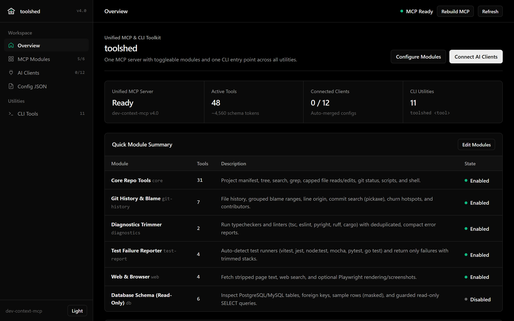
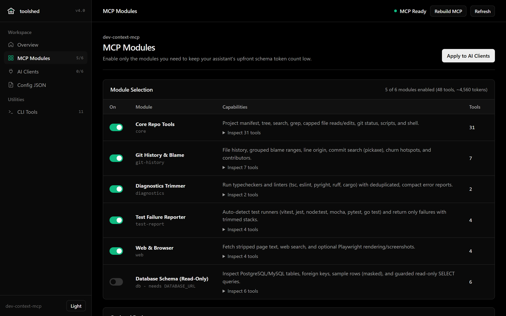
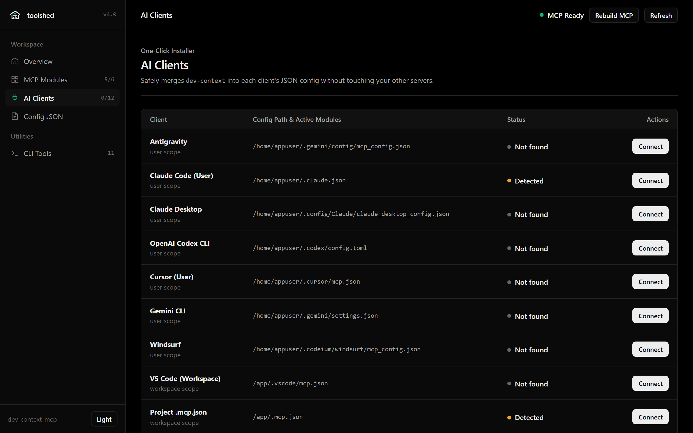
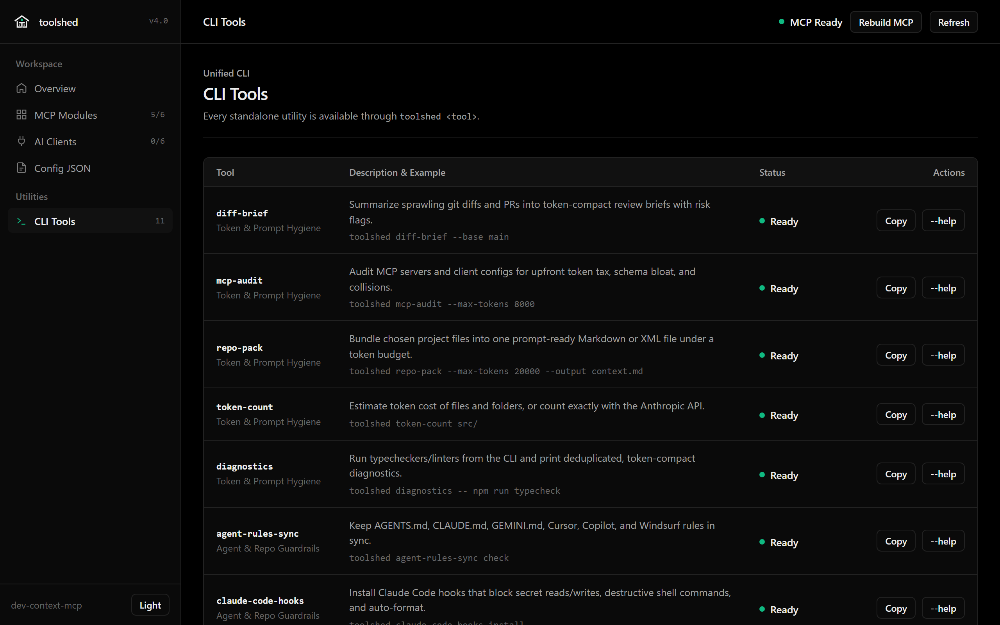

<p align="center">
  
</p>

# toolshed

Open source developer tools for faster, leaner, AI-assisted coding.

[](LICENSE)
[](https://github.com/1nn0v8r/toolshed/actions/workflows/ci.yml)
[](https://github.com/1nn0v8r/toolshed/actions/workflows/repo-checks.yml)


---

## Contents

- [Why toolshed](#why-toolshed)
- [Tools](#tools)
  - [MCP servers for AI assistants](#mcp-servers-for-ai-assistants)
  - [Token and prompt hygiene](#token-and-prompt-hygiene)
  - [Agent and repo guardrails](#agent-and-repo-guardrails)
  - [Codebase and release maintenance](#codebase-and-release-maintenance)
- [Quick start](#quick-start)
- [Workflows that pair well](#workflows-that-pair-well)
- [What belongs here](#what-belongs-here)
- [Repository layout](#repository-layout)
- [Guides and tips](#guides-and-tips)
- [Releases](#releases)
- [Roadmap](#roadmap)
- [Contributing](#contributing)
- [License](#license)

---

## Why toolshed

AI coding assistants are great until the plumbing gets in the way:

- **Context bloat burns budget and degrades reasoning.** Raw `git diff`, full test logs, noisy typechecker dumps, and bloated MCP tool schemas routinely consume tens of thousands of tokens before the model writes a single line of code.
- **Multi-assistant repos drift.** Teams juggling `AGENTS.md`, `CLAUDE.md`, `GEMINI.md`, Cursor rules, and Copilot instructions end up with contradictory rules and broken file references.
- **Guardrails belong in deterministic code, not prompts.** Blocking leaked secrets, `.env` files, personal paths, and destructive shell commands should happen automatically via hooks and CLIs, not by hoping an agent remembers a rule.

**toolshed** is a unified developer toolkit built around those problems:

- **One MCP server, toggleable modules:** [`dev-context-mcp`](tools/dev-context-mcp) bundles repo search/read/edit, git history & blame, deduplicated diagnostics, failure-only test reporting, web browsing, and optional read-only DB inspection into a single MCP server. Enable only the modules you want.
- **Visual Web UI + interactive CLI installer:** Run `npm run ui` (`toolshed ui`) to toggle modules, connect Claude Code, Claude Desktop, Cursor, VS Code, Windsurf, or Gemini CLI with one click, and browse CLI tools visually - or run `npm run setup` (`toolshed setup`) in your terminal.
- **One CLI command for everything:** Install once (`npm install -g .`) to run `toolshed ui`, `toolshed setup`, `toolshed mcp`, and any standalone CLI (`toolshed diff-brief`, `toolshed mcp-audit`, `toolshed commit-guard`, etc.).
- **Zero-bloat engineering:** The root `toolshed` CLI/UI and 9 of the 10 standalone CLIs have **zero runtime dependencies** and run directly with `node`.
- **Tested on Windows, macOS, and Linux** across Node.js 20 and 22 in [CI](.github/workflows/ci.yml).

---

## Tools

All tools support **Windows, macOS, and Linux** and require **Node.js 20+**.

### Unified MCP server for AI assistants

Configure **one** MCP server ([dev-context-mcp](tools/dev-context-mcp), Stable 4.0.0) and toggle the modules you need via `toolshed ui`, `toolshed setup`, or `MCP_MODULES`:

| Module | What it does | Default |
|---|---|---|
| `core` | Repo orientation, capped file search/read/edit, git status, scripts, and shell. | ON |
| `git-history` | File history, grouped blame, line origin, commit search (pickaxe), churn, and contributors. | ON |
| `diagnostics` | Runs project typecheckers and linters (`tsc`, `eslint`, `pyright`, `ruff`, `cargo`) with deduplicated output. | ON |
| `test-report` | Auto-detects test runners and returns only failing tests with trimmed stacks. | ON |
| `web` | Fetches stripped page text, web search, and optional Playwright browsing/screenshots. | ON |
| `db` | Read-only PostgreSQL/MySQL schema inspection and guarded `SELECT` queries. | Auto (when `DATABASE_URL` is set) |

### Token and prompt hygiene

Measure, audit, summarize, and pack what goes into a model's context window.

| Tool | What it does | Type | Runtime deps | Status |
|---|---|---|---|---|
| [diff-brief](tools/diff-brief) | Summarizes sprawling git diffs and PRs into token-compact review briefs with risk flags, lockfile deltas, and symbol changes. | CLI | Zero | Beta (0.1.0) |
| [mcp-audit](tools/mcp-audit) | Audits MCP servers and client configs (`.mcp.json`, Cursor, VS Code) for upfront token tax, schema bloat, tool collisions, and config hygiene. | CLI | Zero | Beta (0.1.0) |
| [repo-pack](tools/repo-pack) | Bundles chosen project files into one prompt-ready Markdown or XML file within a hard token budget. | CLI | 1 (`picomatch`) | Beta (0.1.0) |
| [token-count](tools/token-count) | Estimates the token cost of files and folders, or counts exactly with the Anthropic API. | CLI | Zero | Beta (0.1.0) |

### Agent and repo guardrails

Keep instruction files aligned and stop secrets, personal paths, or destructive commands before they happen.

| Tool | What it does | Type | Runtime deps | Status |
|---|---|---|---|---|
| [agent-rules-sync](tools/agent-rules-sync) | Keeps AI coding instruction files (`AGENTS.md`, `CLAUDE.md`, `GEMINI.md`, Cursor `.mdc`, Copilot, Windsurf) in sync and catches drift, broken references, and token bloat in CI. | CLI | Zero | Beta (0.1.0) |
| [claude-code-hooks](tools/claude-code-hooks) | Claude Code hooks that block reading secret files, writing secrets, and destructive shell commands, and auto-format edits. Includes an installer. | Hooks | Zero | Beta (0.1.0) |
| [commit-guard](tools/commit-guard) | Pre-commit hook and CLI that blocks secrets, personal paths, `.env` files, oversized files, and typographic punctuation. | CLI, git hook | Zero | Beta (0.1.0) |
| [prompt-shield](tools/prompt-shield) | Detects and strips invisible Unicode, ASCII smuggling, Trojan Source bidi controls, and prompt injection across AI rules, diffs, and MCP servers. | CLI | Zero | Experimental (0.1.0) |
| [skill-lint](tools/skill-lint) | Validates Agent Skills (`SKILL.md`) against the open spec, audits startup token budgets, checks broken script/reference links, and flags risky tool permissions. | CLI | Zero | Beta (0.1.0) |

### Codebase and release maintenance

Fast, deterministic CLIs for everyday repository hygiene.

| Tool | What it does | Type | Runtime deps | Status |
|---|---|---|---|---|
| [changelog-gen](tools/changelog-gen) | Turns commit messages into Keep a Changelog entries, with per-tool tags and paths for monorepos. | CLI | Zero | Beta (0.1.0) |
| [dep-check](tools/dep-check) | Scans codebases for unused, missing, and misplaced dependencies in `package.json`. | CLI | Zero | Beta (0.1.0) |
| [env-check](tools/env-check) | Finds env vars your code reads that `.env.example` does not document, and stale ones it does. | CLI | Zero | Beta (0.1.0) |
| [flake-check](tools/flake-check) | Scans test files for non-deterministic anti-patterns and stress-runs test commands to catch flaky tests and timing outliers. | CLI | Zero | Experimental (0.1.0) |

<!--
Add new tools to the matching category table above, one row each, in alphabetical order.
Status values: Experimental, Beta, Stable, Deprecated.
-->

---

## Quick start

**Prerequisites:** [Node.js 20+](https://nodejs.org) (and `git` for git-aware tools), or Docker.

### Fastest: Install in one command (no clone required)

**With Node.js (recommended for one-click local AI client setup):**

```bash
npm install -g https://github.com/1nn0v8r/toolshed/releases/download/toolshed%401.0.0/toolshed-1.0.0.tgz
toolshed ui
```

**With Docker (GHCR):**

```bash
docker run --rm -p 127.0.0.1:4317:4317 ghcr.io/1nn0v8r/toolshed:latest
```

Then open **http://127.0.0.1:4317** in your browser.

---

### From source

Clone the repository once:

```bash
git clone https://github.com/1nn0v8r/toolshed.git
cd toolshed
```

### Option 1: Visual Web UI installer (recommended)

Launch the zero-dependency local dashboard (`http://127.0.0.1:4317`) to toggle MCP modules, connect your AI clients with one click, and browse CLI tools:

```bash
npm run ui
```

<p align="center">
  
</p>

<details>
<summary>More screenshots: MCP Modules, AI Clients, and CLI Tools</summary>

<p><strong>Toggleable MCP Modules</strong> (control upfront schema token cost)</p>


<p><strong>One-Click AI Client Installer</strong> (Antigravity, Claude Code, Claude Desktop, OpenAI Codex CLI, Cursor, Gemini CLI, Windsurf, VS Code, Project .mcp.json, Cline, Roo Code, Zed)</p>


<p><strong>Unified CLI Utilities</strong></p>


</details>

### Option 2: Interactive CLI setup

Prefer the terminal? Run the guided CLI setup wizard:

```bash
npm run setup
```

Or put the unified `toolshed` command on your `PATH`:

```bash
npm install -g .

toolshed ui                 # Visual installer & dashboard
toolshed setup              # Interactive CLI setup wizard
toolshed status             # Check MCP build & connected AI clients
toolshed diff-brief --base main
toolshed mcp-audit --max-tokens 8000
toolshed commit-guard check --staged
```

### Option 3: Docker Compose stack

Run both the Web UI (`http://127.0.0.1:4317`) and the unified `dev-context-mcp` HTTP server (`http://127.0.0.1:4318/mcp`) in containers:

```bash
docker compose up -d --build
```

### Option 4: Manual MCP registration

You can also build and register [`dev-context-mcp`](tools/dev-context-mcp) manually - see [Using MCP servers](docs/using-mcp-servers.md) or [dev-context-mcp](tools/dev-context-mcp#connect-your-assistant).

---

## Workflows that pair well

Every tool works on its own, and several combine cleanly into low-token developer workflows:

### 1. Keep your AI context lean

Measure before you paste, bundle under a hard ceiling, and summarize diffs instead of dumping raw patches:

```bash
# 1. Check which files are expensive before sending them
toolshed token-count src/

# 2. Pack only relevant source files under a 20k token budget
toolshed repo-pack --include "src/**" --exclude "test/**" --max-tokens 20000 --output context.md

# 3. Generate a compact PR brief with risk flags and key hunks
toolshed diff-brief --base main --format md
```

See [Token-Efficient Context Bundling](docs/tips/01-token-efficient-context-bundling.md) for a step-by-step walkthrough.

### 2. Cut MCP overhead and noisy tool output

Audit your existing MCP servers to see what is eating context before you even type a prompt, then swap noisy shell calls for capped MCP tools:

```bash
# Measure upfront token tax and schema bloat across your MCP config
toolshed mcp-audit --max-tokens 8000
```

Pair with [dev-context-mcp](tools/dev-context-mcp) (one unified MCP server with toggleable `core`, `git-history`, `diagnostics`, `test-report`, `web`, and `db` modules).

### 3. Put deterministic guardrails on AI-assisted repos

```bash
# Keep AGENTS.md, CLAUDE.md, GEMINI.md, Cursor, and Copilot rules in sync
toolshed agent-rules-sync check --max-tokens 1500 --strict

# Install the pre-commit hook to block secrets, .env files, and personal paths
toolshed commit-guard install

# Install Claude Code hooks to block secret reads and destructive commands
toolshed claude-code-hooks install
```

---

## What belongs here

Tools that make developers faster, especially when working with AI assistants:

- **MCP servers** that give assistants better context for fewer tokens
- **CLIs** for repetitive developer chores and CI checks
- **Automation** such as git hooks, Claude Code hooks, and scripts
- **Configs and templates** that are worth sharing

Every tool follows the same rules:

- **Works on Windows, macOS, and Linux**, or clearly says which platforms it supports.
- **Installs in a few commands**, documented in its own README.
- **Stands alone.** No tool depends on another tool's folder.
- **Contains no secrets, personal data, or machine-specific paths.**

---

## Repository layout

```
toolshed/
├── bin/toolshed.js         unified zero-dependency CLI entrypoint
├── cli/                    client config manager (12 AI clients), setup wizard, and Web UI
├── test/                   root CLI and Web UI tests
├── tools/                  standalone tool folders + unified dev-context-mcp
│   └── dev-context-mcp/
│       ├── README.md       install, usage, configuration
│       ├── CHANGELOG.md    version history
│       ├── src/            TypeScript server and module router
│       ├── modules/        git-history, diagnostics, test-report, db-schema modules
│       ├── test/           module unit and integration tests
│       └── package.json    manifest with typecheck, build, and test scripts
├── docs/                   shared guides, UI screenshots, and workflow tips
├── .github/                CI matrix, PR checks, repo checks, Dependabot, release workflow
├── Dockerfile              container image for toolshed-ui and dev-context-mcp
├── docker-compose.yml      local Docker stack (UI on 4317, MCP HTTP on 4318)
├── package.json            root toolshed package manifest
├── CHANGELOG.md            root release history
├── .commit-guard.json      repo-wide guardrail config (enforced in CI)
├── CONTRIBUTING.md
├── SECURITY.md
└── LICENSE                 GNU AGPL-3.0-only
```

---

## Guides and tips

| Document | Covers |
|---|---|
| [Using MCP servers](docs/using-mcp-servers.md) | What MCP is and how to register `dev-context-mcp` with common AI coding assistants. |
| [Token-efficient context bundling](docs/tips/01-token-efficient-context-bundling.md) | 3-step workflow for keeping prompts compact with `token-count` and `repo-pack`. |
| [Adding a tool](docs/adding-a-tool.md) | Folder layout, README template, CI matrix, and release tags for a new tool. |
| [Branching and releases](docs/releasing.md) | Protected `main`, issue-first pull requests, versioning, changelogs, and automated releases. |

---

## Releases

The unified `toolshed` package and individual tools follow [Semantic Versioning](https://semver.org):

```
v1.0.0                   # Root toolshed release (GitHub Release + .tgz + ghcr.io Docker image)
dev-context-mcp@4.0.0    # Per-tool release (GitHub Release + .tgz tarball)
```

Every tag triggers [.github/workflows/release.yml](.github/workflows/release.yml) to verify the version, extract release notes from `CHANGELOG.md`, attach the `.tgz` tarball, and (for root releases) push the Docker image to `ghcr.io`. `main` is protected and always releasable; see [Branching and releases](docs/releasing.md) for the full process.

---

## Roadmap

Ideas under consideration. Open an issue to suggest one or to vote with a reaction.

- [x] Unified `dev-context-mcp` v4 with toggleable modules
- [x] Unified `toolshed` CLI, interactive setup wizard, and visual Web UI (12 AI clients)
- [x] Automated GitHub Releases with `.tgz` tarballs and `ghcr.io` Docker images
- [ ] Publish to public npm registry for `npx toolshed ui`
- [ ] More workflow tips in [`docs/tips/`](docs/tips)
- [ ] More tools: open a feature request with the "New tool" option

---

## Contributing

Bug reports, ideas, and pull requests are welcome. Read the [contributing guide](CONTRIBUTING.md) first; it covers setup, commit style, and how to add a tool.

To report a security problem, follow the [security policy](SECURITY.md) instead of opening a public issue.

---

## License

[AGPL-3.0](LICENSE). Use, modify, and share these tools freely.
